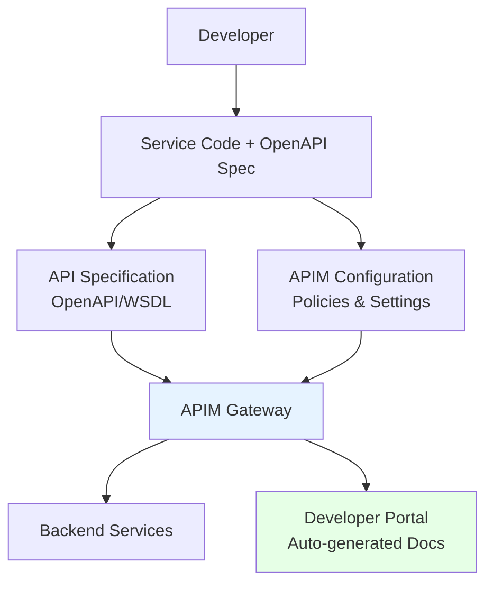
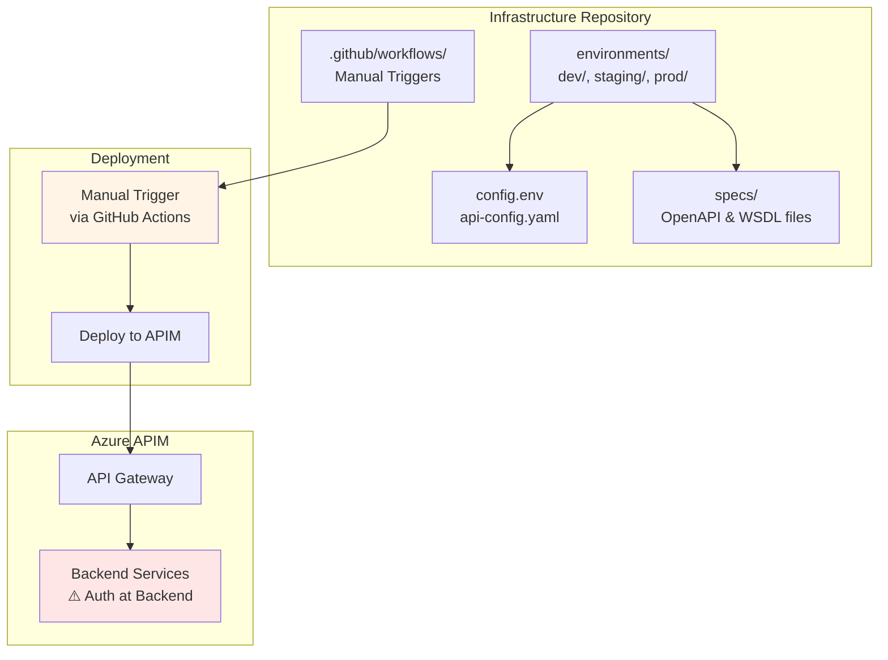
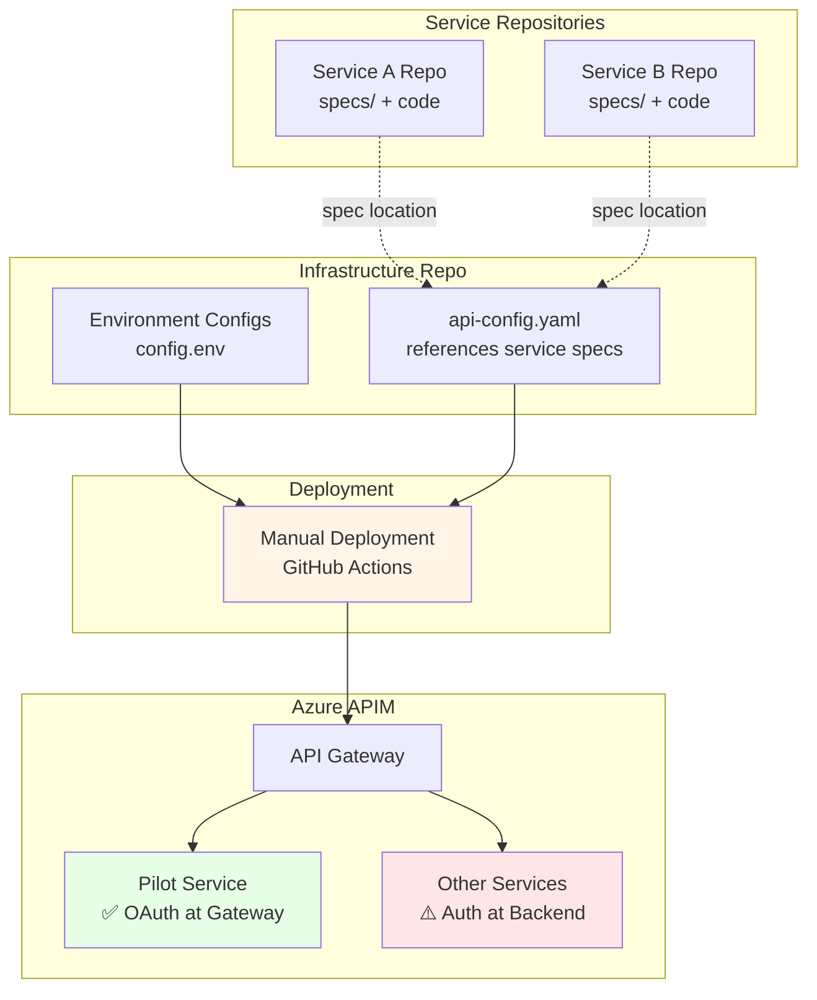
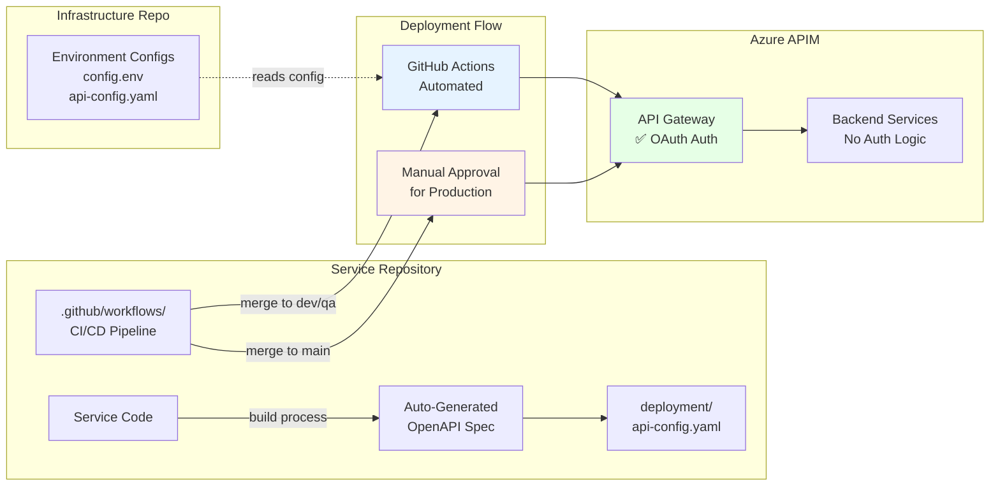
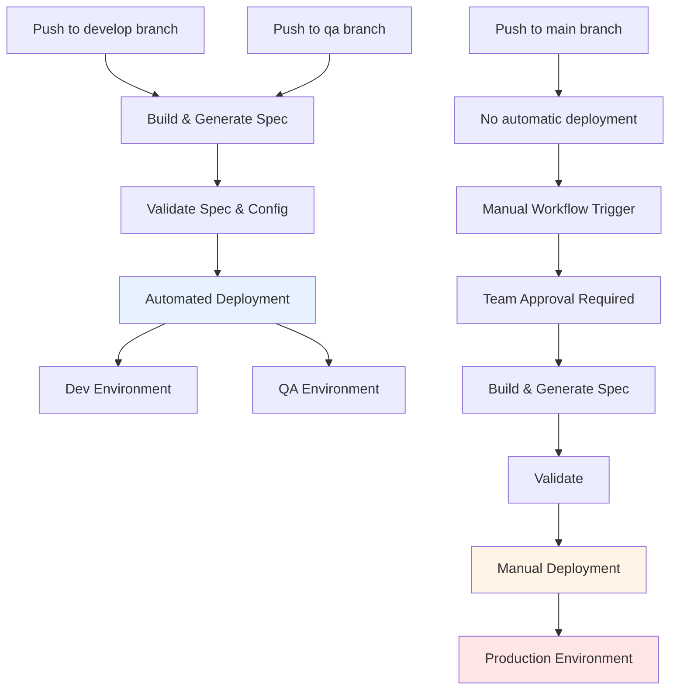
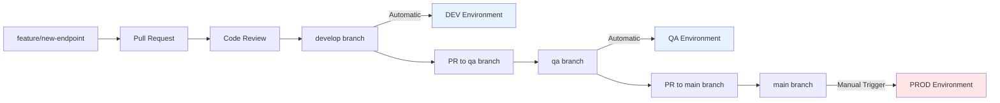
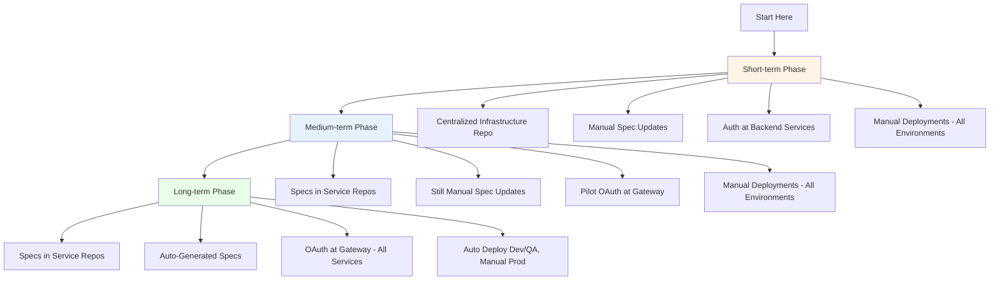

# Azure API Management: Developer Guide

## Table of Contents
1. [What is Azure API Management?](#what-is-azure-api-management)
2. [Common Use Cases](#common-use-cases)
3. [Integration with Your Development Process](#integration-with-your-development-process)
4. [Short-term Deployment Strategy](#short-term-deployment-strategy)
5. [Medium-term Deployment Strategy](#medium-term-deployment-strategy)
6. [Long-term Deployment Strategy](#long-term-deployment-strategy)
7. [Deployment Strategy Comparison](#deployment-strategy-comparison)
8. [Migration Path: Evolving Your APIM Strategy](#migration-path-evolving-your-apim-strategy)
9. [Next Steps for Developers](#next-steps-for-developers)

---

## What is Azure API Management?

**Azure API Management (APIM)** is a fully managed service that enables organizations to publish, secure, transform, maintain, and monitor APIs. Think of it as a **gateway layer** that sits between your backend services and the consumers of your APIs.

### Core Capabilities

- **API Gateway**: Single entry point for all API calls with routing, load balancing, and caching
- **Security**: Authentication, authorization, rate limiting, and IP filtering
- **Transformation**: Request/response transformation, protocol mediation (REST to SOAP, etc.)
- **Monitoring**: Built-in analytics, logging, and alerting
- **Developer Portal**: Self-service API documentation and subscription management
- **Versioning & Products**: Manage multiple API versions and group APIs into products

### Why APIM?

Instead of managing these concerns in each individual service, APIM provides a centralized platform to:
- Enforce consistent security policies across all APIs
- Provide unified monitoring and analytics
- Shield backend services from direct exposure
- Enable rapid API publishing without code changes

---

## Common Use Cases

### 1. API Consolidation
**Problem**: Multiple services with inconsistent authentication, monitoring, and documentation.

**Solution**: APIM provides a unified API gateway where all services are published with consistent:
- Authentication mechanisms (OAuth 2.0, JWT, API keys)
- Rate limiting and quotas
- Logging and monitoring
- Documentation in a single developer portal

### 2. Legacy System Modernization
**Problem**: Need to expose legacy SOAP services to modern REST clients.

**Solution**: APIM can transform between protocols:
- Expose SOAP services as REST APIs
- Add modern authentication to legacy services
- Cache responses to reduce backend load
- Version APIs while maintaining backward compatibility

### 3. External Partner Integration
**Problem**: Need to securely expose internal APIs to external partners with different access levels.

**Solution**: APIM's product and subscription model allows you to:
- Create different product tiers (starter, professional, enterprise)
- Set different rate limits per partner
- Track usage and generate analytics per subscriber
- Revoke access without changing backend services

### 4. Microservices Gateway
**Problem**: Managing service-to-service communication, security, and monitoring in microservices architecture.

**Solution**: APIM acts as an API gateway providing:
- Service mesh capabilities
- Centralized authentication and authorization
- Circuit breaker patterns
- Request routing and aggregation
- Distributed tracing

### 5. Mobile and SPA Backends
**Problem**: Mobile apps and single-page applications need optimized API responses and caching.

**Solution**: APIM enables:
- Response compression and transformation
- Intelligent caching strategies
- Rate limiting to prevent abuse
- API composition (backend-for-frontend pattern)

---

## Integration with Your Development Process

### Current State: Traditional Development


### Future State: APIM-Enhanced Development



### What Changes for Developers?

#### Minimal Changes Required
1. **Add API Specification**: Create an OpenAPI (Swagger) spec for your service
2. **Add APIM Configuration**: Small YAML file describing APIM-specific settings
3. **Maintain Your Service**: Continue developing as usual

#### What You Gain
- Automatic API documentation
- Built-in security and rate limiting
- Monitoring and analytics without code changes
- Versioning support
- Easy integration with partner systems

### Development Workflow Comparison

| Activity                | Before APIM                    | With APIM (Short-term)             | With APIM (Long-term)              |
|-------------------------|--------------------------------|------------------------------------|------------------------------------|
| **Authentication**      | Implement in each service      | Managed at backend service         | Centralized OAuth at gateway       |
| **Rate Limiting**       | Custom code per service        | Policy-based configuration         | Policy-based configuration         |
| **API Documentation**   | Manual maintenance             | Auto-generated from OpenAPI spec   | Auto-generated from OpenAPI spec   |
| **Monitoring**          | Custom logging per service     | Built-in APIM analytics            | Built-in APIM analytics            |
| **Partner Access**      | Direct database/API keys       | Subscription-based with portal     | Subscription-based with portal     |
| **API Versioning**      | URL/header management in code  | APIM version management            | APIM version management            |

---

## Short-term Deployment Strategy

### Overview: Manual Deployments with Centralized Infrastructure

In the short term, we use a **centralized infrastructure repository** for all APIM deployments with **authentication remaining at the backend services**. This approach is ideal for:
- Initial setup and learning
- Proof-of-concept deployments
- Getting familiar with APIM concepts
- Manual control over all environment deployments

### Repository: [example-apim-infrastructure](https://github.com/shane-m-holland/example-apim-infrastructure)

### Architecture



### Developer Workflow

#### Step 1: Add Your API Specification
```bash
# Clone the infrastructure repository
git clone https://github.com/your-org/example-apim-infrastructure.git
cd example-apim-infrastructure

# Add your OpenAPI specification
cp /path/to/your/openapi.yaml specs/my-service-api.yaml
```

#### Step 2: Update API Configuration
Edit `environments/dev/api-config.yaml`:

```yaml
apis:
  - name: my-service-api
    displayName: "My Service API"
    description: "API for my awesome service"
    path: /my-service
    serviceUrl: https://my-service.azurewebsites.net
    subscriptionRequired: true
    protocols:
      - https
    specificationFormat: openapi+json
    specificationPath: specs/my-service-api.yaml
    products:
      - unlimited
    policies:
      inbound:
        - type: rate-limit
          calls: 100
          renewal-period: 60
    # Note: Authentication handled by backend service initially
```

#### Step 3: Create Pull Request
```bash
git checkout -b add-my-service-api
git add specs/my-service-api.yaml environments/dev/api-config.yaml
git commit -m "Add My Service API to APIM"
git push origin add-my-service-api
```

#### Step 4: Manual Deployment
After PR approval and merge:
1. Navigate to GitHub Actions in the infrastructure repository
2. Select "Deploy Infrastructure" workflow
3. Click "Run workflow"
4. Select environment: `dev`
5. Click "Run workflow" button

#### Step 5: Verify Deployment
```bash
# Check API in Azure Portal
# Or use Azure CLI
az apim api show \
  --resource-group rg-apim-dev \
  --service-name apim-dev-instance \
  --api-id my-service-api
```

### Pros and Cons

**Advantages:**
- Simple to understand and manage
- Single source of truth for all APIs
- Easy to see all deployed APIs
- Good for initial learning phase

**Disadvantages:**
- All teams share one repository (potential conflicts)
- Manual deployment steps
- API specs separate from service code
- Longer feedback loop

---

## Medium-term Deployment Strategy

### Overview: Service-Managed Specs with Manual Deployments

The medium-term strategy moves API specifications into service repositories while maintaining manual deployment control. This phase also introduces **piloting authentication at the gateway** for select services.

**Key Changes:**
- API specs managed in service repositories (still manually updated)
- Manual deployments for all environments
- Pilot OAuth/JWT authentication at APIM gateway for selected services
- Begin transition from backend authentication

### Architecture: Hybrid Approach



### Developer Workflow

#### Step 1: Move Specs to Service Repository
```bash
# In your service repository
mkdir specs
cp /path/from/infrastructure-repo/specs/my-api.yaml specs/api.openapi.yaml
git add specs/
git commit -m "Move API spec to service repository"
git push
```

#### Step 2: Update Infrastructure Configuration
Edit `environments/dev/api-config.yaml` in infrastructure repo to reference service repo spec:

```yaml
apis:
  - name: my-service-api
    displayName: "My Service API"
    description: "API for my awesome service"
    path: /my-service
    serviceUrl: https://my-service.azurewebsites.net
    subscriptionRequired: true
    protocols:
      - https
    specificationFormat: openapi+json
    # Reference spec in service repo (for manual deployment, path provided during deploy)
    specificationPath: specs/api.openapi.yaml
    products:
      - unlimited
    policies:
      inbound:
        - type: rate-limit
          calls: 100
          renewal-period: 60
    # Note: Auth still at backend for most services
```

#### Step 3: Configure Gateway Auth for Pilot Services

For services participating in the OAuth pilot, add JWT validation:

```yaml
apis:
  - name: pilot-service-api
    displayName: "Pilot Service API (Gateway Auth)"
    description: "Pilot service with OAuth at gateway"
    path: /pilot-service
    serviceUrl: https://pilot-service.azurewebsites.net
    subscriptionRequired: true
    protocols:
      - https
    specificationFormat: openapi+json
    specificationPath: specs/pilot-api.openapi.yaml
    products:
      - unlimited
    policies:
      inbound:
        # NEW: OAuth validation at gateway
        - type: jwt-validate
          header-name: Authorization
          failed-validation-httpcode: 401
          require-expiration-time: true
          require-signed-tokens: true
          openid-config-url: "https://login.microsoftonline.com/{tenant-id}/.well-known/openid-configuration"
          audiences:
            - "api://your-app-id"
        - type: rate-limit
          calls: 100
          renewal-period: 60
```

#### Step 4: Update Pilot Service (Remove Backend Auth)

For pilot services, remove authentication logic from backend:

```python
# Before (with backend auth)
@app.get("/users")
async def get_users(token: str = Depends(verify_token)):
    # verify_token validates JWT
    return users

# After (gateway handles auth)
@app.get("/users")
async def get_users():
    # Gateway already validated token
    # User info available in forwarded headers if needed
    return users
```

#### Step 5: Manual Deployment

Deployment remains manual, but now references specs from service repositories:

1. Ensure service repository has latest spec
2. Navigate to infrastructure repo GitHub Actions
3. Trigger "Deploy APIs" workflow
4. Workflow fetches specs from service repositories
5. Deploys to APIM

### Pros and Cons

**Advantages:**
- Specs co-located with service code
- Pilot OAuth without full commitment
- Learn gateway auth with limited risk
- Manual control maintained during transition

**Disadvantages:**
- Still manual deployment process
- Specs must be manually maintained
- Coordination required between repos
- Pilot services need backend changes

---

## Long-term Deployment Strategy

### Overview: Automated CI/CD with Generated Specs

The long-term strategy achieves full automation with **auto-generated API specifications** and **centralized authentication at the gateway**. This enables:
- Autonomous service teams
- Automated deployments to dev/QA environments
- API specs auto-generated from code during build
- Manual deployments to production (with approval gates)
- OAuth authentication enforced at gateway level

### Architecture: Multi-Repository Approach



### Service Repository: [apim-service-example-py](https://github.com/shane-m-holland/apim-service-example-py)

### Service Repository Structure
```
my-python-service/
├── src/
│   ├── main.py                    # Your service code
│   ├── routes/
│   └── models/
│
├── specs/
│   └── api.openapi.yaml          # OpenAPI specification
│
├── deployment/
│   └── api-config.yaml           # APIM configuration
│
├── .github/workflows/
│   ├── deploy-api.yml            # Automated APIM deployment
│   └── validate-api.yml          # PR validation
│
├── requirements.txt
└── README.md
```

### Developer Workflow (Automated)

#### Step 1: Develop Your Service Normally
```bash
# Your existing development process
git clone https://github.com/your-org/my-python-service.git
cd my-python-service

# Make changes to your service
vim src/main.py

# Test locally
python src/main.py
```

#### Step 2: Auto-Generate API Specification
In the long-term approach, OpenAPI specs are auto-generated during the build process:

```python
# export_openapi_yaml.py (runs during CI/CD build)
from fastapi.openapi.utils import get_openapi
from main import app
import yaml

def export_openapi():
    openapi_schema = get_openapi(
        title=app.title,
        version=app.version,
        routes=app.routes,
    )

    with open("specs/api.openapi.yaml", "w") as f:
        yaml.dump(openapi_schema, f)

if __name__ == "__main__":
    export_openapi()
```

```yaml
# .github/workflows/build.yml
name: Build and Generate Spec
on: [push]
jobs:
  build:
    runs-on: ubuntu-latest
    steps:
      - uses: actions/checkout@v3
      - name: Setup Python
        uses: actions/setup-python@v4
        with:
          python-version: '3.11'
      - name: Install dependencies
        run: pip install -r requirements.txt
      - name: Generate OpenAPI Spec
        run: python export_openapi_yaml.py
      - name: Upload spec artifact
        uses: actions/upload-artifact@v3
        with:
          name: openapi-spec
          path: specs/api.openapi.yaml
```

#### Step 3: Configure APIM Settings with Gateway Authentication
```yaml
# deployment/api-config.yaml
apis:
  - name: my-python-service
    displayName: "My Python Service"
    description: "RESTful API for my Python service"
    path: /my-service
    serviceUrl: ${SERVICE_URL}  # Environment variable
    subscriptionRequired: true
    protocols:
      - https
    specificationFormat: openapi+json
    specificationPath: specs/api.openapi.yaml
    products:
      - unlimited
    policies:
      inbound:
        # OAuth validation at gateway (long-term approach)
        - type: jwt-validate
          header-name: Authorization
          failed-validation-httpcode: 401
          require-expiration-time: true
          require-signed-tokens: true
          openid-config-url: "https://login.microsoftonline.com/{tenant}/.well-known/openid-configuration"
        # Rate limiting
        - type: rate-limit
          calls: 100
          renewal-period: 60
```

#### Step 4: Commit and Push
```bash
git checkout -b add-new-endpoint
git add src/ specs/ deployment/
git commit -m "Add new user endpoint"
git push origin add-new-endpoint
```

#### Step 5: Create Pull Request
- Create PR on GitHub
- Automated validation runs:
  - OpenAPI spec validation
  - APIM config syntax check
  - Configuration validation against environment
- Team reviews and approves

#### Step 6: Deployment (Automated for Dev/QA, Manual for Production)
```yaml
# .github/workflows/deploy-api.yml
name: Deploy API to APIM

on:
  push:
    branches:
      - develop  # Auto-deploy to dev
      - qa       # Auto-deploy to QA
  workflow_dispatch:  # Manual trigger for production
    inputs:
      environment:
        description: 'Environment to deploy to'
        required: true
        type: choice
        options:
          - prod
          - staging

jobs:
  deploy:
    runs-on: ubuntu-latest
    steps:
      - name: Checkout code
        uses: actions/checkout@v3

      - name: Generate OpenAPI Spec
        run: python export_openapi_yaml.py

      - name: Checkout infrastructure config
        uses: actions/checkout@v3
        with:
          repository: your-org/example-apim-infrastructure
          path: infra-config
          token: ${{ secrets.CONFIG_REPO_TOKEN }}

      - name: Deploy to APIM
        uses: your-org/apim-tooling/.github/workflows/deploy-api.yml@main
        with:
          environment: ${{ github.event.inputs.environment || 'dev' }}
          api-config-path: deployment/api-config.yaml
          api-spec-path: specs/api.openapi.yaml
          config-repo-path: infra-config
```

**Deployment Flow:**



### Branch Strategy

#### Development → Production Flow



#### Environment Mapping

| Branch    | Environment | Deployment          | Approval Required |
|-----------|-------------|---------------------|-------------------|
| `develop` | dev         | Automatic on merge  | No                |
| `qa`      | qa          | Automatic on merge  | No                |
| `main`    | prod        | Manual trigger only | Yes (recommended) |

### Pros and Cons

**Advantages:**
- API specs live with service code
- Automated deployments (no manual steps)
- Team autonomy (each service manages own API)
- Fast feedback loop
- Built-in validation and testing
- Audit trail via Git history

**Disadvantages:**
- More complex initial setup
- Requires CI/CD pipeline configuration
- Needs infrastructure config repository access
- Requires understanding of GitHub Actions

---

## Deployment Strategy Comparison

| Aspect                  | Short-term              | Medium-term                      | Long-term                        |
|-------------------------|-------------------------|----------------------------------|----------------------------------|
| **Repository Model**    | Centralized             | Hybrid (specs in services)       | Distributed (per service)        |
| **API Specs Location**  | Infrastructure repo     | Service repo                     | Service repo                     |
| **Spec Management**     | Manual updates          | Manual updates                   | Auto-generated from code         |
| **Authentication**      | Backend services        | Pilot OAuth at gateway           | OAuth at gateway (centralized)   |
| **Deployment Trigger**  | Manual (all envs)       | Manual (all envs)                | Auto (dev/QA), Manual (prod)     |
| **Team Autonomy**       | Low (shared repo)       | Medium (own specs)               | High (own specs & deployment)    |
| **Complexity**          | Simple                  | Moderate                         | Advanced                         |
| **Best For**            | Learning, initial setup | Piloting, transitioning          | Production, scaling teams        |
| **Feedback Loop**       | Hours                   | Hours                            | Minutes (dev/QA), Hours (prod)   |

---

## Migration Path: Evolving Your APIM Strategy



### Short-term Phase: Foundation

**Goal:** Establish APIM infrastructure and learn the platform

**Milestones:**
- [ ] Deploy APIM infrastructure to dev environment
- [ ] Onboard first APIs to APIM via centralized repo
- [ ] Establish manual deployment process
- [ ] Document authentication patterns at backend

**Key Characteristics:**
- **API Specs:** Managed in infrastructure repository (`specs/` directory)
- **Spec Updates:** Manual - developers update YAML/JSON files directly
- **Authentication:** Remains at backend services (no changes to existing auth)
- **Deployments:** Manual via GitHub Actions UI for all environments
- **Duration:** Approximately 1-2 months

**Success Criteria:**
- All team members can manually deploy API changes
- Developer Portal is accessible with test subscriptions
- Monitoring and analytics are reviewed regularly

---

### Medium-term Phase: Transition & Pilot

**Goal:** Move specs closer to service code and pilot gateway authentication

**Milestones:**
- [ ] Move API specs to individual service repositories
- [ ] Select 1-2 services for OAuth pilot at gateway
- [ ] Configure JWT validation policies in APIM
- [ ] Update pilot services to expect auth validation at gateway
- [ ] Document OAuth configuration for other teams
- [ ] Maintain manual deployment process

**Key Characteristics:**
- **API Specs:** Managed in service repositories (`specs/` in each service)
- **Spec Updates:** Still manual - developers update alongside service changes
- **Authentication:** Pilot OAuth/JWT validation at APIM gateway for selected services
- **Deployments:** Manual via GitHub Actions UI for all environments
- **Duration:** Approximately 2-3 months

**Success Criteria:**
- Pilot services successfully authenticate via gateway
- Other teams can reference pilot implementation
- No authentication logic changes in pilot service backends
- Clear documentation on gateway auth configuration

---

### Long-term Phase: Full Automation

**Goal:** Achieve automated deployments with auto-generated specs and centralized auth

**Milestones:**
- [ ] Implement spec auto-generation in build pipelines
- [ ] Migrate all services to OAuth at gateway
- [ ] Configure automated deployments to dev/QA environments
- [ ] Establish approval gates for production deployments
- [ ] Remove authentication logic from backend services
- [ ] Monitor and optimize deployment pipelines

**Key Characteristics:**
- **API Specs:** Auto-generated from service code during build process
- **Spec Updates:** Automatic - specs generated from code annotations/decorators
- **Authentication:** OAuth/JWT validation at gateway for all services
- **Deployments:** Automated to dev/QA on merge, manual trigger for production
- **Duration:** Ongoing - continuous improvement

**Success Criteria:**
- Zero manual steps to deploy API changes to dev/QA
- Production deployments require only approval (no manual config)
- All services use centralized OAuth at gateway
- API documentation auto-updates on every deployment
- Deployment time < 5 minutes for dev/QA environments

---

## Next Steps for Developers

### Getting Started

#### 1. Learn APIM Basics
- [ ] Review this guide and example repositories
- [ ] Explore the [Azure APIM Documentation](https://docs.microsoft.com/azure/api-management/)
- [ ] Understand [OpenAPI Specification](https://swagger.io/specification/) basics
- [ ] Review [apim-service-example-py](https://github.com/shane-m-holland/apim-service-example-py) example

#### 2. Prepare Your First API
- [ ] Identify your first API to onboard to APIM
- [ ] Create or review existing OpenAPI specification
  - Use [Swagger Editor](https://editor.swagger.io/) for validation
  - Or generate from code (FastAPI, ASP.NET Core, Spring Boot, etc.)
- [ ] Document current authentication mechanism
- [ ] Identify service URL for dev environment

#### 3. Deploy to Dev Environment
- [ ] Clone the infrastructure repository
- [ ] Add your OpenAPI spec to `specs/` directory
- [ ] Create API configuration in `environments/dev/api-config.yaml`
- [ ] Create pull request with your changes
- [ ] Trigger manual deployment to dev via GitHub Actions
- [ ] Verify deployment in Azure Portal

#### 4. Test and Validate
- [ ] Get subscription key from Azure Portal or Developer Portal
- [ ] Test API endpoints through APIM gateway:
  ```bash
  curl -H "Ocp-Apim-Subscription-Key: {your-key}" \
    https://apim-dev.azure-api.net/your-service/endpoint
  ```
- [ ] Review APIM analytics for your API
- [ ] Test rate limiting and other policies
- [ ] Verify error responses and logging

#### 5. Plan for Medium-term
- [ ] Identify services for OAuth pilot at gateway
- [ ] Review authentication requirements and token formats
- [ ] Plan repository structure for service-managed specs
- [ ] Document current backend authentication patterns

#### 6. Prepare for Long-term
- [ ] Investigate spec auto-generation tools for your framework
- [ ] Plan CI/CD pipeline enhancements
- [ ] Consider branch strategy for automated deployments
- [ ] Identify testing requirements for automated deployments

### Learning Resources

#### Official Documentation
- [Azure APIM Documentation](https://docs.microsoft.com/azure/api-management/)
- [OpenAPI Specification 3.0](https://swagger.io/specification/)
- [GitHub Actions Documentation](https://docs.github.com/actions)
- [OAuth 2.0 and JWT Best Practices](https://oauth.net/2/)

#### Example Repositories
- **Infrastructure Repository**: [example-apim-infrastructure](https://github.com/shane-m-holland/example-apim-infrastructure)
  - Review environment configurations
  - Understand API configuration patterns
  - See manual deployment workflows

- **Python Service Example**: [apim-service-example-py](https://github.com/shane-m-holland/apim-service-example-py)
  - Service repository structure
  - OpenAPI spec generation
  - Deployment configuration

#### Hands-on Practice
1. **Deploy Sample API**: Use the example-py repository as a template
2. **Test APIM Features**: Experiment with policies like:
   - Rate limiting
   - Response caching
   - Header transformation
   - Mock responses
3. **Explore Developer Portal**:
   - Create test subscriptions
   - Review auto-generated documentation
   - Test APIs interactively
4. **Review Analytics**:
   - Check APIM analytics dashboard
   - Monitor API performance
   - Review error rates and trends

---

## Common Questions

### Q: Do I need to change my existing service code?
**A:** No! Your service code remains unchanged. You only need to:
1. Create/maintain an OpenAPI specification
2. Add a small APIM configuration file
3. Deploy through APIM instead of directly

### Q: What if my API doesn't have an OpenAPI spec?
**A:** You have options:
1. Generate it automatically (FastAPI, ASP.NET Core, etc.)
2. Use tools like [Swagger Editor](https://editor.swagger.io/)
3. Create it manually (we can help!)
4. For SOAP services, use your existing WSDL

### Q: How long does APIM deployment take?
**A:**
- Initial infrastructure: 30-45 minutes (one-time)
- API deployment: 2-5 minutes per API
- Automated deployment (long-term): 3-5 minutes total

### Q: Can I test locally before deploying to APIM?
**A:** Yes! You can:
1. Validate OpenAPI spec using online tools
2. Test your service directly (before APIM)
3. Use dry-run mode: `./apim.sh deploy apis dev --dry-run`
4. Deploy to dev environment first

### Q: What happens if deployment fails?
**A:**
- GitHub Actions logs show detailed error messages
- Previous API version remains active (no downtime)
- You can rollback by redeploying a previous commit
- Infrastructure team can assist with troubleshooting

### Q: How do we handle secrets and API keys?
**A:**
- Backend service URLs can use environment variables
- Secrets stored in Azure Key Vault (referenced in APIM)
- GitHub repository secrets for CI/CD credentials
- APIM subscription keys generated automatically

### Q: Can we have different configurations for dev/staging/prod?
**A:** Yes! Use environment variable substitution:
```yaml
serviceUrl: ${SERVICE_URL}  # Different per environment
```

Each environment has its own config file with different values.

---

## Summary

### Key Takeaways

1. **APIM is a Gateway**: Centralized management for rate limiting, monitoring, documentation, and (eventually) authentication
2. **Minimal Code Changes**: Add OpenAPI spec and configuration - your service code stays largely unchanged
3. **Three-Phase Evolution**:
   - **Short-term**: Centralized repo, manual specs, backend auth, manual deployments
   - **Medium-term**: Specs in service repos, pilot gateway auth, manual deployments
   - **Long-term**: Auto-generated specs, gateway auth, automated deployments (dev/QA)
4. **Gradual Migration**: Progress through phases at your team's pace
5. **Authentication Evolution**: Start with backend auth, pilot at gateway, eventually centralize all auth at gateway

### Success Criteria by Phase

**Short-term Success:**
- [ ] APIM infrastructure deployed and accessible
- [ ] First 2-3 APIs onboarded successfully
- [ ] Team comfortable with manual deployment process
- [ ] Developer Portal configured with test subscriptions
- [ ] Monitoring and analytics reviewed regularly

**Medium-term Success:**
- [ ] API specs managed in service repositories
- [ ] Pilot OAuth service authenticating at gateway
- [ ] Documentation updated for gateway auth patterns
- [ ] Team ready to scale gateway auth to more services

**Long-term Success:**
- [ ] Specs auto-generated from service code
- [ ] All services use OAuth at gateway
- [ ] Automated deployments to dev/QA environments
- [ ] Manual approval process for production
- [ ] Deployment time < 5 minutes for dev/QA

### Get Started Today

1. **Review**: Check out the [example repositories](https://github.com/shane-m-holland)
2. **Learn**: Complete the learning resources in "Next Steps for Developers"
3. **Prepare**: Identify your first API and create/review its OpenAPI spec
4. **Deploy**: Follow the short-term workflow to deploy to dev
5. **Test**: Validate your API works through APIM gateway
6. **Plan**: Discuss medium-term transition with your team

---

**Questions or issues?** Reach out to the infrastructure team or check the [CI/CD documentation](CICD.md).
